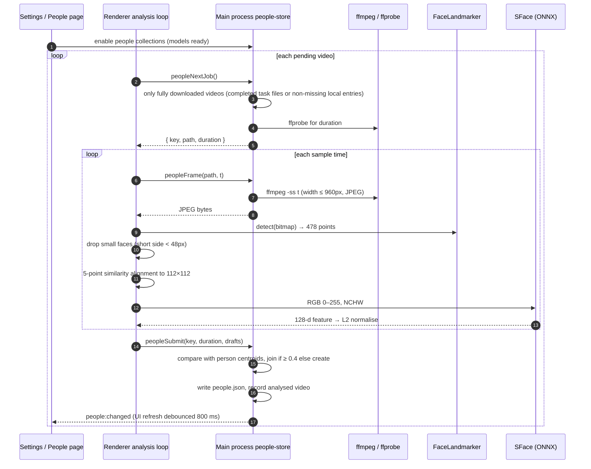
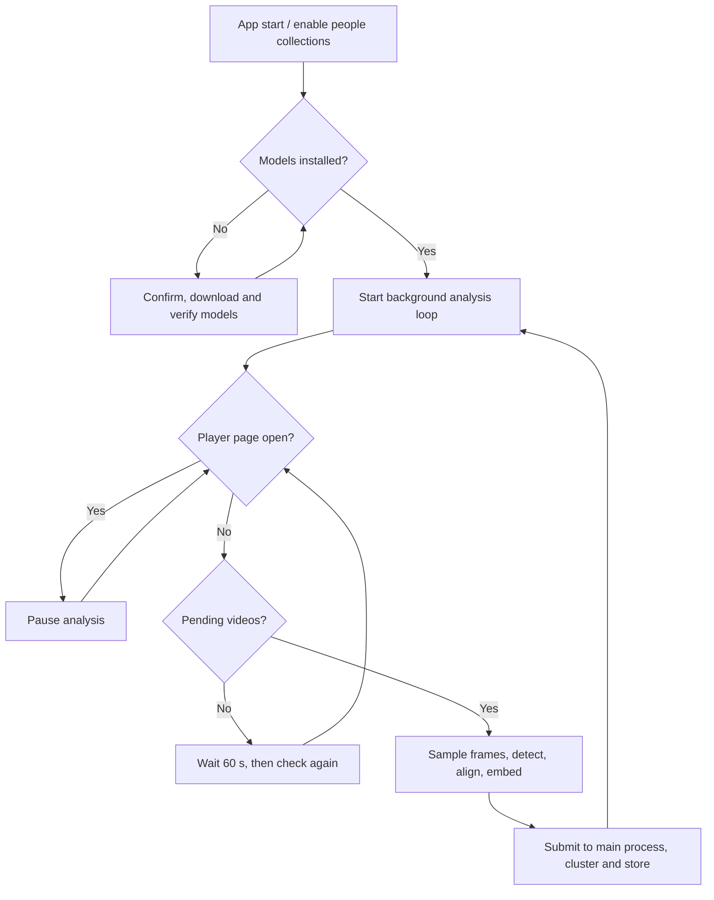

# People collections: face analysis

[简体中文](./face-analysis.md)

People collections analyse **fully downloaded** videos in the background, detect the faces that appear in them, and group them automatically into "people" by similarity. All processing happens on this machine; no frames or face data are uploaded. The feature is off by default and is enabled under **Settings → People collections**.

## Enabling and models

Enabling it first shows a confirmation dialog explaining that about 42 MB of models will be downloaded:

| Model | Purpose | Size | Source |
| --- | --- | --- | --- |
| `face_landmarker.task` | Face detection and 478 landmarks (MediaPipe) | ~3.8 MB | Google's official storage |
| `face_recognition_sface_2021dec.onnx` | 128-dimensional face embedding (SFace, ONNX) | ~38.7 MB | Hugging Face `opencv/face_recognition_sface` (Apache-2.0) |

Models are stored under `models/` in the app data directory. Each download is verified against a pinned SHA256; a failed check is not installed. The ONNX Runtime WASM runtime ships with the app, so no network access is needed at analysis time.

## Sequence diagram

## Flowchart

## Clustering rules

- Each face is compared by cosine similarity with the **centroid** of each existing person. If the best score is ≥ **0.4** the face joins that person; otherwise a new person is created. The threshold is a conservative default and should be calibrated on real footage.
- Person thumbnails are ordered by similarity to the centroid, so the most representative faces come first.
- When merging, an unnamed target inherits the source's name. If both are named, the target's name is kept.

## Sampling

- Sample interval = `max(5 s, duration / 60)`; at most about 60 frames per video. The first interval and the last second are skipped.
- A frame that fails to decode or infer is skipped. If a whole video fails, the loop backs off for 5 seconds.
- Videos whose probe fails are not retried during the same run.

## Data and privacy

- Data lives in `people.json` in the app data directory: people, face embeddings (128-dimensional vectors), aligned thumbnails (JPEG, a few KB each) and the analysed-video record.
- Video files are never modified.
- **Settings → People collections → Clear people data** deletes all of the above and turns the feature off.

## Relationship with other features

- Analysis pauses while the player page is open, so it does not compete with video decoding.
- People can be used as a library filter, and as the "includes person" condition of smart collections (see the [README](../README.en.md)).
- Gesture control shares the MediaPipe runtime, but its models are separate (see [Gesture control](./gesture-control.en.md)).

## Known limitations

- The clustering threshold has not been calibrated on real data, so faces may be merged or split incorrectly. Use the People page to merge or split manually.
- The person detail view shows at most 120 face thumbnails.
- Data is stored as JSON. With very large libraries (tens of thousands of faces) the file and summary computation will get slower; migrating to a database is a possible future step.
- The training-data licence of SFace has not been verified and must be checked before release.
