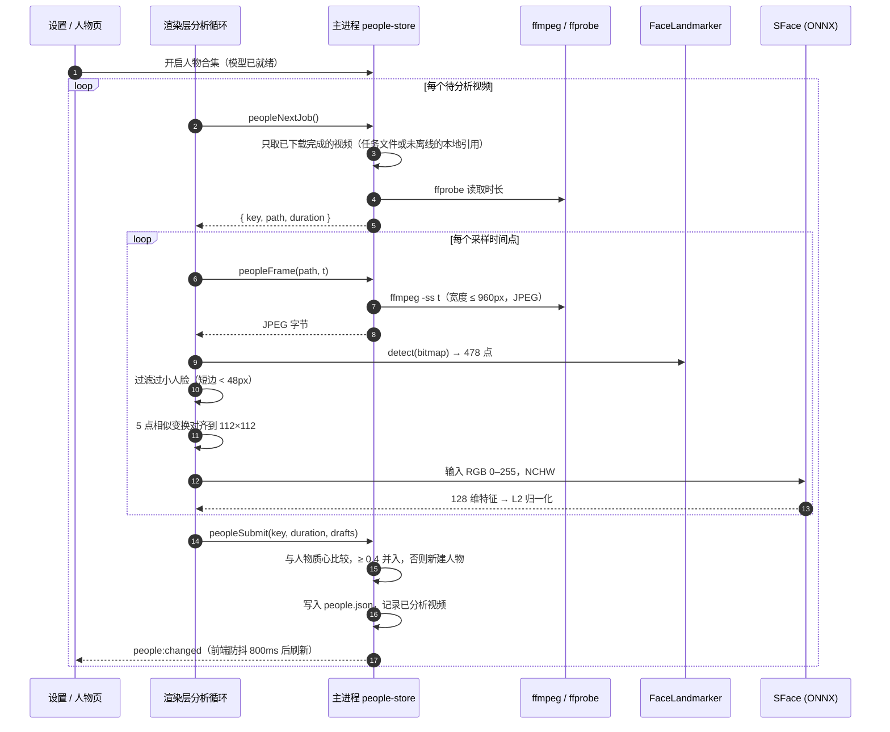
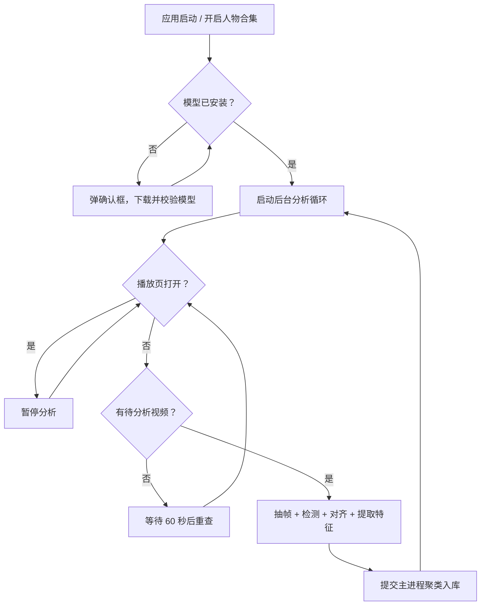

# 人物合集：人脸分析

[English](./face-analysis.en.md)

人物合集在后台分析**已下载完成**的视频，检测其中出现的人脸，按相似度自动归组为「人物」。全部处理在本机完成，不上传画面或人脸数据。功能默认关闭，在「设置 → 人物合集」开启。

## 开启与模型

开启时会先弹出确认框，说明需要下载约 42 MB 的模型：

| 模型 | 用途 | 大小 | 来源 |
| --- | --- | --- | --- |
| `face_landmarker.task` | 检测人脸与 478 个关键点（MediaPipe） | 约 3.8 MB | Google 官方存储 |
| `face_recognition_sface_2021dec.onnx` | 提取 128 维人脸特征（SFace，ONNX） | 约 38.7 MB | Hugging Face `opencv/face_recognition_sface`（Apache-2.0） |

模型保存在应用数据目录的 `models/` 下，下载后按固定 SHA256 校验，校验失败不会安装。ONNX Runtime 的 WASM 运行时随应用分发，不需要联网。

## 时序图

## 功能流程图

## 聚类规则

- 每张人脸与已有人物的**质心**计算余弦相似度；最高值 ≥ **0.4** 时并入该人物，否则新建人物。阈值是保守默认值，需用真实片源标定。
- 人物卡片的缩略图按与质心的相似度排序，最像该人的在前。
- 合并时，若目标人物未命名而来源已命名，则继承来源名称。

## 抽帧策略

- 采样间隔 = `max(5 秒, 时长 / 60)`，单片最多约 60 帧，跳过开头第一个间隔和结尾 1 秒。
- 单帧解码或推理失败只跳过该帧；整段视频失败时退避 5 秒后再试。
- 探测失败的视频在本次运行中不再重试。

## 数据与隐私

- 数据保存在应用数据目录的 `people.json`：人物、人脸特征（128 维向量）、对齐后的缩略图（JPEG，约数 KB）和已分析记录。
- 视频文件本身不会被修改。
- 「设置 → 人物合集 → 清除人物数据」会删除以上全部数据，并关闭人物合集。

## 与其它功能的关系

- 播放页打开时分析会暂停，避免与视频解码争抢 CPU。
- 人物可作为媒体库的筛选条件，也可作为智能合集的「包含人物」条件（见 [README](../README.md)）。
- 手势控制与人物合集共用 MediaPipe 运行时，但模型相互独立（见 [手势识别](./gesture-control.md)）。

## 已知限制

- 聚类阈值未经真实数据标定，可能出现误合并或漏合并，可在人物页手动合并、拆分。
- 人物详情最多显示 120 张人脸缩略图。
- 数据以 JSON 存储，人脸数量很大（数万级）时文件和汇总计算会变慢，之后可迁移到数据库。
- SFace 的训练数据许可尚未核实，发布前需确认。
