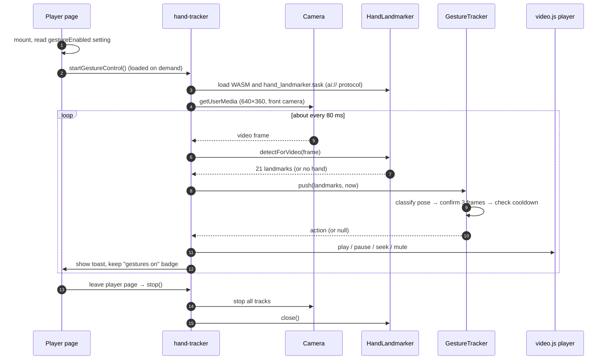
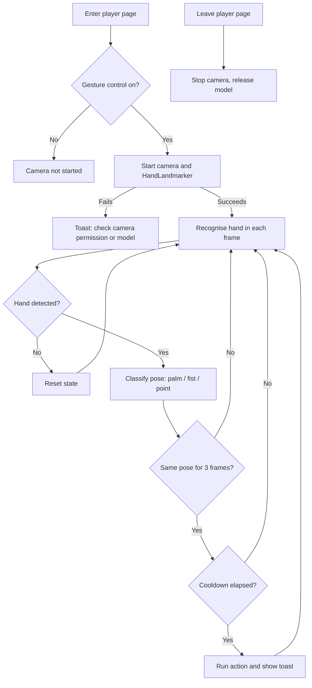

# Gesture control

[简体中文](./gesture-control.md)

Gesture control uses the camera on the **player page** to recognise hand poses for play/pause, seeking and mute. It is optional and off by default; enable it under **Settings → MediaPipe enhancements**. Camera frames are processed only on this machine and never uploaded.

## Enabling and the model

If the gesture model is missing when you enable the feature, a confirmation dialog first explains that about 7.5 MB of MediaPipe `hand_landmarker.task` will be downloaded. The file is verified against a pinned SHA256. The model is independent of the people-collection models.

## Gestures and actions

| Gesture | Action | Notes |
| --- | --- | --- |
| Open palm | Play / pause | Triggers after ~3 confirmed frames; no repeat for 1 s |
| Index finger swiped toward your right | Forward 5 s | Swipe must cover 18% of the frame width within 500 ms |
| Index finger swiped toward your left | Back 5 s | Same as above |
| Fist | Mute / unmute | Triggers after ~3 confirmed frames; no repeat for 1.2 s |

The camera image is not mirrored, so a swipe toward your own right appears as a decrease in x. The code classifies that direction as "forward".

## Sequence diagram

## Flowchart

## Implementation notes

- **Classification is pure**: a finger counts as extended when its fingertip is more than 1.2× as far from the wrist as its PIP joint. The thumb is ignored because it is often occluded.
- **Edge-triggered**: a held gesture fires once and does not repeat.
- **Cost**: inference runs at about 12 fps on 640×360 frames. People analysis pauses while the player is open to avoid competing for CPU.
- **GPU fallback**: the GPU delegate is preferred and falls back to CPU if it fails.
- **Permissions**: macOS needs camera access (`NSCameraUsageDescription` and the `com.apple.security.device.camera` entitlement). Development builds may be unable to use the camera because they lack the usage description.

## Known limitations

- Recognition degrades in low light, when the hand is occluded, or with several people in frame.
- Swipe distance and cooldowns are set from typical use; they should be tuned on real hardware.
- The camera is used only on the player page and is released when you leave it. The "gestures on" badge indicates that the camera is active.
