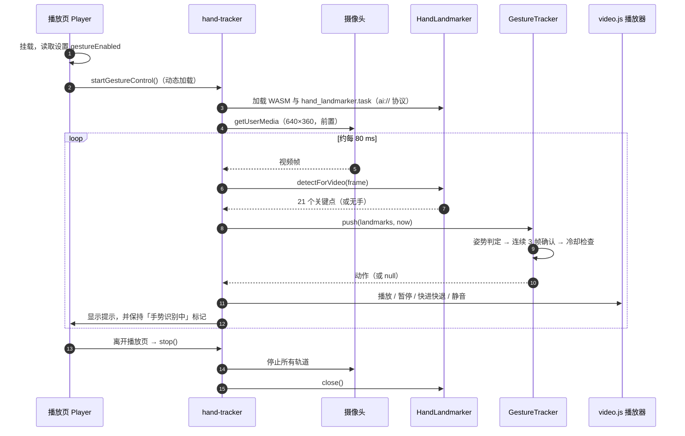
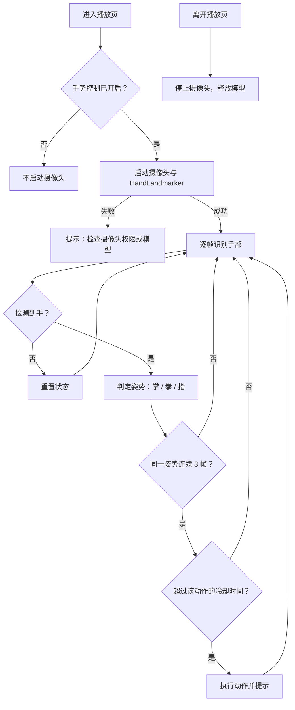

# 手势识别

[English](./gesture-control.en.md)

手势控制在**播放页**内用摄像头识别手的动作，控制播放、快进快退和静音。它是可选功能，默认关闭，在「设置 → MediaPipe 增强」开启。摄像头画面只在本机处理，不会上传。

## 开启与模型

开启时若手势模型缺失，会先弹出确认框，下载约 7.5 MB 的 MediaPipe `hand_landmarker.task`，并按固定 SHA256 校验。模型与人物合集的模型相互独立。

## 手势与动作

| 手势 | 动作 | 说明 |
| --- | --- | --- |
| 张开手掌 | 播放 / 暂停 | 保持约 3 帧后触发，触发后 1 秒内不重复 |
| 食指向自己右侧挥动 | 快进 5 秒 | 挥动距离超过画面宽度的 18%，500 ms 内完成 |
| 食指向自己左侧挥动 | 快退 5 秒 | 同上 |
| 握拳 | 静音 / 取消静音 | 保持约 3 帧后触发，触发后 1.2 秒内不重复 |

摄像头画面未镜像，因此「食指向自己右侧挥动」在画面中表现为 x 坐标减小，代码中据此判定为快进。

## 时序图

## 功能流程图

## 实现要点

- **判定是纯函数**：手指是否伸直，按指尖与 PIP 关节到腕部的距离比较（比值 1.2）；拇指不参与判定，因为容易被遮挡。
- **边沿触发**：同一手势只触发一次，持续保持不会重复执行。
- **资源开销**：推理约 12 fps，输入为 640×360 的画面；播放页内人物分析会暂停，避免争抢 CPU。
- **GPU 回退**：优先使用 GPU delegate，失败后自动回退 CPU。
- **权限**：macOS 需要摄像头权限（`NSCameraUsageDescription` 与 `com.apple.security.device.camera` 授权）；开发版可能因为缺少用途说明而无法访问摄像头。

## 已知限制

- 光线较暗、手部被遮挡或多人同框时识别率会下降。
- 手势阈值（挥动距离、冷却时间）按常见手感设定，实际手感需要在真机上调整。
- 摄像头只在播放页内使用，离开页面即释放；页面上的「手势识别中」标记用于提示摄像头正在工作。
